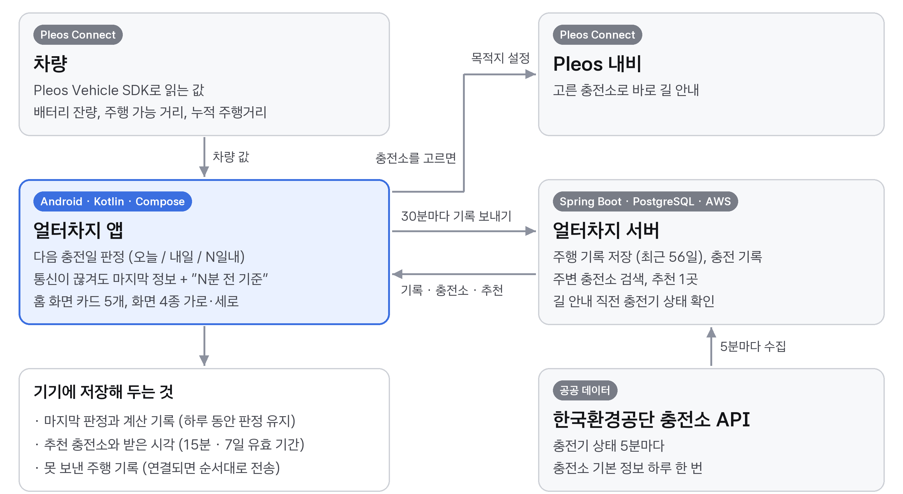

# 얼터차지 (AlterCharge)

차량 데이터로 **다음 충전일을 먼저 알려 주고**, 충전할 곳까지 차 안에서 정하게 해 주는 Pleos Connect 전기차 앱입니다.
현대자동차그룹 차량용 앱 개발 공모전 출품작입니다.

- 충전소 "찾기" 앱은 많지만, 얼터차지는 **"언제 충전할지"** 를 먼저 알려 줍니다.
- 배터리 잔량과 최근 주행 기록으로 "오늘 충전 / 내일 충전 / N일내 충전"을 판정합니다.
- 충전이 필요하면 주변 충전소와 빈 충전기 수를 보여 주고, 고르면 바로 내비 목적지가 됩니다.

| 항목 | 내용 |
|---|---|
| 팀명 | 얼터차지 |
| APK | `apk/얼터차지_AlterCharge_release.apk` (제출 시 추가) |
| 테스트 환경 | Pleos Connect Emulator v2.1.0 (Automotive, Android API 34), RAM 4GB |
| 서버 저장소 | [altercharge-server](https://github.com/2026-Hyundai-Car-Contest/altercharge-server) |

## 핵심 기능

**1차 (공모전 제출)**

- **다음 충전일 알려 주기**: 주행 기록을 자동으로 모아 어제까지 14일의 일 평균과 예비 거리로 판정합니다. 기록이 14일이 안 되면 "기록 수집 중"을 보여 줍니다.
- **충전할 곳 정하기**: 주변 충전소를 거리순·방문순으로 보여 주고, 연결 타입과 충전 속도로 거를 수 있습니다. 추천 충전소 1곳도 따로 보여 줍니다.
- **충전 중 상태**: 충전 중, 완료, 오류와 남은 시간, 완료 예정 시각을 차량 상태 카드에서 보여 줍니다.
- **주간 주행 기록**: 요일별 주행거리, 하루 평균, 지난주 대비, 마지막 충전 후 주행 거리를 보여 줍니다.

**2차 (이후)**: 주행 중 음성 안내와 "응/아니" 응답, 도착 요약 화면, 집·회사 거점 자동 등록

## 전체 구성



- **차량 앱**: 다음 충전일을 직접 계산하고, 주차 중 홈 화면에 카드 5개로 보여 줍니다.
- **서버**: 주행 기록과 충전소 정보를 모아 둡니다. 공공 충전기 상태를 5분마다 받아 주변 충전소 검색, 추천, 길 안내 전 상태 확인을 맡습니다.
- **외부 데이터**: 차량 데이터는 Pleos Vehicle SDK로 차에서 바로 읽고, 충전소 정보는 서버가 한국환경공단 충전소 정보 API에서 받습니다.

## 개발하면서 신경 쓴 점

- **끊겨도 쓸 수 있게**: 통신이 끊겨도 마지막으로 받은 판정과 충전소 정보를 그대로 보여 줍니다. 대신 "10분 전 기준"처럼 언제 받은 정보인지 함께 알리고, 빈 충전기 수처럼 금방 바뀌는 값은 15분이 지나면 "정보 없음"으로 바꿔 틀린 안내를 막습니다.
- **믿을 수 있는 판정**: 판정이 하루 동안 쉽게 바뀌지 않게 했습니다. 그날 첫 실행, 충전 완료, 오늘 주행이 예비 거리를 넘었을 때만 다시 계산합니다.
- **판정은 차에서 계산**: 서버가 잠깐 멈춰도 다음 충전일은 계속 나옵니다. 계산을 서버가 아니라 앱에서 하기 때문입니다.
- **기록은 잃지 않게**: 못 보낸 주행 기록은 차에 모아 두었다가 연결되면 순서대로 보내고, 같은 기록을 다시 보내도 서버에는 한 번만 저장됩니다.
- **차량 화면에 맞춘 디자인**: Pleos 디자인 값(색, 글자, 여백)을 옮긴 디자인 시스템을 먼저 만들고, 화면 4종(S-17, W-Standard, W-Extended, WF)의 가로와 세로를 시안과 픽셀 단위로 맞췄습니다. 한국어·영어, 라이트·다크 모드를 지원합니다.
- **테스트**: 판정 계산, 유효 기간, 서버 연동은 단위 테스트 150여 건으로 확인합니다.

## 기술 스택

| 구분 | 사용 |
|---|---|
| 차량 앱 | Kotlin, Jetpack Compose, Pleos Vehicle SDK 2.3.2, `minSdk 28` / `targetSdk 34` |
| 서버 | Spring Boot, PostgreSQL, Docker, AWS EC2 (HTTPS) |
| 외부 데이터 | 한국환경공단 전기차 충전소 정보 API |
| 빌드 · 검사 | Gradle 8.9 (JDK 17), Android lint, JUnit, GitHub Actions |

## 실행 방법

**APK로 실행**: Pleos Connect 에뮬레이터에 `apk/` 폴더의 APK를 설치합니다.

```bash
adb install apk/얼터차지_AlterCharge_release.apk
adb shell am start -W --display 0 -n com.altercharge.app/.MainActivity
```

**소스로 실행**: 아래 [개발 환경 세팅](#개발-환경-세팅)을 마친 뒤 `./scripts/run.sh`를 실행합니다.
출시 빌드는 배포 서버(`https://15-164-244-37.sslip.io/api/v1/`)에, 디버그 빌드는 개발 PC의 로컬 서버(`10.0.2.2:8080`)에 연결됩니다.

## 폴더 구조

```
app/src/main/java/com/altercharge/app/
├─ ui/
│  ├─ designsystem/   # 색 · 글자 · 여백 토큰, 버튼, 상단 바, 화면 4종 레이아웃 틀
│  ├─ card/           # info(다음 충전일) · driverecord(주간 기록) · vehiclestatus(차량 상태) · station(추천 충전소) · stationitem(충전소 목록)
│  └─ common/         # 드롭다운, 검색창
├─ domain/
│  ├─ judgment/       # 충전 판정 계산과 다시 계산하는 시점
│  └─ time/           # 날짜 기준 시간대(한국시간)
└─ data/
   ├─ remote/         # 서버 API 호출, JSON 변환, 카드 값 변환, 유효 기간
   ├─ local/          # 오프라인용 마지막 값 저장
   ├─ upload/         # 주행 기록 전송 주기와 재전송
   └─ home/           # 홈 화면 카드 값을 한 번에 만들기
```

## 알려진 한계

- Pleos의 TextToSpeech, SpeechToText, FusedLocation은 아직 Coming Soon이라 음성 안내는 2차에서 만듭니다.
- 충전 기록은 공모전 서버 정책상 테스트(MOCK) 데이터로 저장되어 방문 횟수에는 반영되지 않습니다.
- 충전소 이름과 주소는 한국환경공단 원본(한국어)을 그대로 보여 줍니다.

---

## 개발 환경 세팅

**스크립트 한 번으로 끝납니다.** (Apple Silicon Mac에서 확인했습니다. Intel Mac과 Linux는 검증하지 못했고, Windows는 아래 "수동 설치"를 따릅니다.)
이미지가 크므로 **와이파이에서, 디스크 여유 26GB 이상**으로 시작합니다.

### 먼저 준비할 것

| 필요한 것 | 확인 / 설치 |
|---|---|
| [Android Studio](https://developer.android.com/studio) 최신 버전 | 설치 후 한 번 실행해서 SDK를 받습니다. Settings > Android SDK > SDK Tools에서 **Android SDK Command-line Tools (latest)** 를 설치합니다. |
| **JDK 17** | `brew install openjdk@17` (Mac). Android Studio에 들어 있는 JDK 25는 Gradle 8.9와 맞지 않습니다. 스크립트가 JDK 17을 알아서 찾습니다. |
| Git | `git --version` |
| 여유 RAM 8GB 이상 | 에뮬레이터가 4GB를 씁니다. |

### 저장소 받고 실행

```bash
git clone https://github.com/2026-Hyundai-Car-Contest/altercharge-app.git
cd altercharge-app
./scripts/setup.sh   # 처음 한 번: JDK 확인, API 34, Pleos 에뮬레이터 이미지, 가상 기기
./scripts/run.sh     # 빌드 + 에뮬레이터 켜기 + 설치 + 실행
```

**라이선스는 직접 읽고 동의해야 합니다.** 설치 단계에서 Google Android SDK와 42dot Pleos SDK 라이선스 동의 질문이 나오면 `yes`를 직접 입력합니다. 이미 동의했다면 `ACCEPT_LICENSES=yes ./scripts/setup.sh`로 건너뛸 수 있습니다.

| 명령 | 하는 일 |
|---|---|
| `./scripts/setup.sh` | 환경 세팅 (처음 한 번) |
| `./scripts/run.sh` | 빌드 + 에뮬레이터 켜기 + 설치 + 실행 |
| `./scripts/check.sh` | 푸시 전 lint와 빌드 확인 (CI와 같은 검사) |
| `./scripts/release.sh 얼터차지` | 제출용 서명 APK를 `apk/얼터차지_AlterCharge_release.apk`로 만들기 (키스토어 필요) |

Android Studio에서 실행하려면 `altercharge-app` 폴더를 Open 하고, 실행 기기로 `Pleos_Connect_API34`를 고른 뒤 Run 합니다. 이때도 **Gradle JDK를 17로 지정**해야 합니다. (Settings > Build, Execution, Deployment > Build Tools > Gradle > Gradle JDK)

디자인 확인용 화면은 디버그 빌드의 카탈로그에서 볼 수 있습니다.

```bash
adb shell am start -W --display 0 -n com.altercharge.app/.debug.DesignCatalogActivity --es page layout
# page: tokens, buttons, statusbar, layout, cards, cv  /  --ez dark true 로 다크 모드
```

### 막혔을 때

| 증상 | 확인할 것 |
|---|---|
| `JDK 17을 찾지 못했어요` | `brew install openjdk@17` 후 다시 실행 |
| 빌드 오류에 `25.0.3` 같은 Java 버전이 나온다 | Gradle이 JDK 25로 돌고 있습니다. JDK 17로 바꿉니다. |
| `BuildConfig`를 찾지 못한다 | Gradle JDK가 17인지 확인하고 Gradle Sync 후 Rebuild Project |
| `Command-line Tools가 없어요` | Android Studio > SDK Tools에서 Command-line Tools (latest) 설치 |
| Android Studio가 "AGP/Gradle 업그레이드"를 권한다 | 무시합니다. JDK 17, compileSdk 34 전제가 깨질 수 있습니다. |
| 다운로드가 끊긴다 | 같은 명령을 다시 실행하면 이어받습니다 |
| 체크섬이 맞지 않는다 | `~/.cache/altercharge/`의 zip을 지우고 다시 실행 |
| 앱이 화면에 안 보인다 | `./scripts/run.sh`를 다시 실행합니다 (메인 화면 0번에 띄웁니다) |

<details>
<summary>수동 설치 (Windows이거나 스크립트가 안 될 때)</summary>

공식 가이드: [개발 환경 구성](https://document.pleos.ai/docs/connect/guide/getting-started/application-development/setup-connect-sdk-emulator)

**A. Pleos 이미지 목록 등록**: Android Studio **Tools > SDK Manager > SDK Update Sites** 탭에서 `+`

- Name: `Pleos Connect System Image`
- URL (Mac M 시리즈): `https://nexus-playground.pleos.ai/repository/raw-releases/connect-avd/2.x/crp-arm64-sys-img.xml`
- URL (Windows, Linux, Intel Mac): `https://nexus-playground.pleos.ai/repository/raw-releases/connect-avd/2.x/crp-sys-img.xml`

**B. 이미지 설치 (약 4.7GB)**

1. SDK Manager > **SDK Platforms** 탭에서 **Android API 34**를 체크합니다.
2. **Show Package Details**를 켜고 **Pleos Connect v2.1.0 APIs** 이미지를 체크합니다.
3. Apply 후 **42dot SDK 라이선스**를 읽고 동의한 경우에만 진행합니다.
4. 설치가 끝나면 Android Studio를 재시작합니다.

**C. 가상 기기 만들기**: **Tools > Device Manager > Create device**

1. Form Factor: **Automotive** > **Pleos Connect v2.1.0** 선택
2. System image: **API 34 / Pleos Connect v2.1.0 APIs**
3. Show Advanced Settings: Default boot **Cold**, RAM **4 GB**

</details>

## 협업 규칙

자세한 내용은 [CONTRIBUTING.md](CONTRIBUTING.md)에 있습니다.

- `main` 하나만 쓰고, 작업은 `type/작업내용` 브랜치에서 해서 PR을 **Squash and Merge**로 합칩니다. `main`에 직접 푸시하지 않습니다.
- 커밋은 `type: 작업 내용` (한국어). 타입: `feat` `fix` `refactor` `style` `chore` `docs` `test`
- 공용 파일(Gradle, 매니페스트, 공통 컴포넌트)을 바꿀 때는 팀에 먼저 알립니다. 푸시 전에는 `./scripts/check.sh`를 돌립니다.
- PR을 열면 담당자 지정, 리뷰어 요청, 라벨, 브랜치 이름·제목 검사, 빌드와 lint(CI)가 자동으로 돕니다. 병합하면 `main`의 디버그 APK가 Actions 결과물로 남습니다.
- 키스토어, `local.properties`, 토큰, API 키는 커밋하지 않습니다.

## 공모전 제출 (접수 마감 2026-11-15)

[지원·제출 방법](https://appdevchallenge.auto-hmg.io/guide/submission) 기준이며, 세부 내용은 공모전 사이트가 우선입니다.

| 항목 | 내용 |
|---|---|
| 필수 | 접수양식(기획서)과 참가자 전원의 개인정보 동의서를 이메일로 제출 |
| 가산점 | 시연 영상, GitHub 저장소(소스 + APK) |
| APK | `apk/` 폴더, 파일명 `팀명_앱이름_release.apk`, 실행 가능한 release 버전 |
| 수정 제출 | 마감 전에 같은 주소로 다시 보내면 마지막 제출본이 최종본 |

**release APK 서명 키**: 키스토어(`*.jks`, `*.keystore`)와 `keystore.properties`는 저장소에 올리지 않습니다(`.gitignore`로 제외). APK는 한 명이 같은 키스토어로 만듭니다. 키스토어가 있는 사람이 저장소 루트에 `keystore.properties`(`storeFile`, `storePassword`, `keyAlias`, `keyPassword`)를 두고 `./scripts/release.sh 얼터차지`를 실행하면, 서명 검증까지 해서 `apk/` 폴더에 정해진 이름으로 만듭니다.

## 참고 문서

- [Pleos 개발 문서 시작하기](https://document.pleos.ai/docs/pleos-only/getting-started)
- [Pleos Connect SDK 사용 가이드](https://document.pleos.ai/docs/pleos-only/connect-sdk-pleos/)
- [SDK API 참조](https://document.pleos.ai/api-reference/connect-sdk-pleos)
- [차량 앱 개발 가이드 (주행 규제, 오디오 포커스 등 정책)](https://document.pleos.ai/docs/pleos-only/vehicle-app-developer-guide/intro)
- [공모전 사이트](https://appdevchallenge.auto-hmg.io/)
